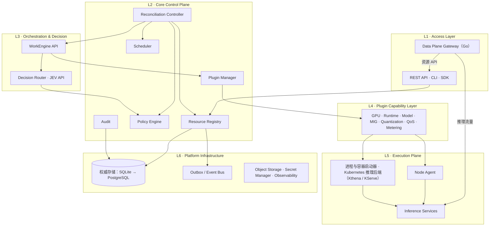
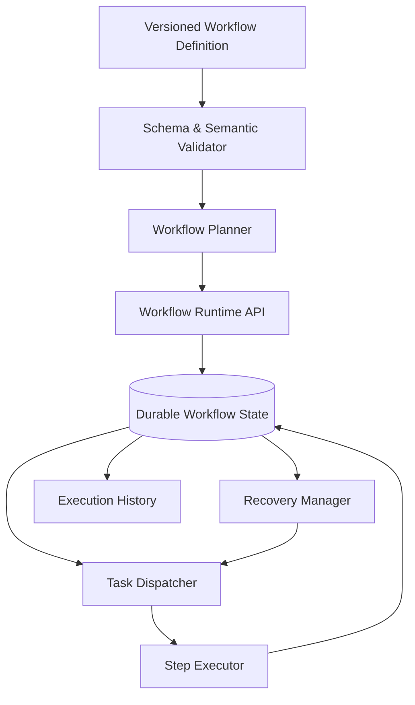
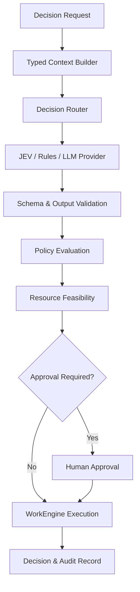

# ForgeMesh 架构设计文档

Architecture Baseline · v1.1 · 2026-10-14（v1.0：2026-10-09）

关键词：已采纳的 ADR · 开源基础设施 · 插件微内核 · 声明式控制平面 · 多租户

项目名称 ForgeMesh 为暂定名称。本文定义目标架构、必须遵循的设计约束和演进路线，不代表所有组件已经实现：各模块与代码的对应关系及实现状态见 [module-mapping.md](module-mapping.md)，1.1.0 之后的阶段与迭代见 [roadmap.md](roadmap.md)。`v1alpha1` 是初始的资源 API 版本，并不意味着接口已经达到稳定版的兼容承诺；对外 API 的稳定性标注见[弃用政策](../governance/deprecation-policy.md) 1.4 节。

## 目录

1. 项目定位与设计目标
2. 已采纳的 ADR 与架构原则
3. 总体架构
4. 核心微内核
5. 声明式资源模型与协调控制器
6. WorkEngine 工作流系统
7. JEV 决策系统
8. 插件系统与扩展协议
9. GPU 与异构算力资源模型
10. Node Agent 与执行平面
11. 多租户、调度、QoS 与计量
12. 数据模型与一致性
13. API 与事件规范
14. 安全架构
15. 可观测性与运维
16. 技术栈
17. 开源项目结构与治理
18. 测试与可靠性要求
19. 实施路线图
20. 架构验收标准
附录 A. 状态转移矩阵
修订记录

# 1. 项目定位与设计目标

## 1.1 项目定位

ForgeMesh 是一个面向 AI 算力基础设施的开源自动化控制平台，负责把 GPU、推理运行时、模型、节点和计算资源组织成可声明、可编排、可治理、可观测的 AI 服务。

它不是单纯的 GPU 自动部署脚本集合，也不是仅依赖 LLM 执行命令的自动化 Agent，而是由声明式资源模型、协调控制器、持久化工作流、类型化决策、策略治理和可插拔执行能力共同组成的基础设施平台。

平台需要支持以下完整生命周期：

- 发现、登记和验证计算节点及 GPU。
- 检查驱动、设备能力、容器运行时与运行环境。
- 自动准备模型、部署推理服务并执行健康验收。
- 通过 JEV（TypeSafe Decision Model）进行结构化决策。
- 通过 WorkEngine 执行可恢复的长流程。
- 管理资源分配、释放、迁移与健康状态。
- 实现多租户、配额、QoS、Token 限流和计量。
- 通过插件支持 NVIDIA、MIG、vLLM 及未来的异构设备和其他推理运行时。
- 为第三方开发者提供稳定的 API、插件 SDK、CLI 和扩展机制。

## 1.2 架构目标

| 目标   | 必须满足的设计要求                           |
| ------ | -------------------------------------------- |
| 可扩展 | 业务能力通过稳定接口扩展，不依赖修改核心代码 |
| 可恢复 | 工作流、资源状态和关键副作用可追踪、可恢复   |
| 可治理 | 决策、授权、资源分配与执行彼此独立           |
| 声明式 | 用户定义目标，控制器持续协调实际状态         |
| 可移植 | GPU、Runtime、工作流引擎与基础设施实现可替换 |
| 多租户 | 身份、资源、工作流、数据与计量具有租户边界   |
| 可观测 | 所有关键操作可通过统一关联 ID 追踪           |
| 可运营 | 支持升级、回滚、恢复、诊断与兼容性检查       |
| 可开源 | 公共契约、开发流程、许可证和兼容策略明确     |

## 1.3 非目标

ForgeMesh 不负责重新实现整个基础设施生态。

- 不自行开发 GPU 驱动或通用容器运行时。
- 不重新实现 vLLM 等推理引擎。
- 不把 Kubernetes 作为唯一的执行后端。
- 不在 Kubernetes 上重新实现已有的推理编排与请求调度框架（如 KServe、Kthena），而是把它们作为执行后端（见 10.4）。
- 不要求所有插件都运行在同一个进程内。
- 不要求所有决策必须由 JEV 或 LLM 完成。
- 不让 LLM 绕过权限、配额、资源调度和安全检查。
- 不在第一阶段同时实现所有厂商 GPU、所有工作流引擎和所有推理 Runtime。

# 2. 已采纳的 ADR 与架构原则

本节列出已采纳的 ADR（ADR-001 至 ADR-014，索引与全文见 [design-decisions](../design-decisions/README.md)）。

这里的“已采纳”表示项目选择了相应的架构方向；具体实现仍需通过接口定义、测试和后续 ADR 完善。

## 2.1 ADR 总表

| ADR     | 决策                               | 架构约束                              |
| ------- | ---------------------------------- | ------------------------------------- |
| ADR-001 | 微内核与插件分离                   | 核心定义稳定契约，插件实现具体能力    |
| ADR-002 | 采用声明式资源模型                 | Desired State 与 Observed State 分离  |
| ADR-003 | WorkEngine 采用可替换 Provider     | 执行引擎不直接决定领域模型            |
| ADR-004 | JEV 不是唯一决策系统               | 支持规则、JEV、LLM 和其他 Provider    |
| ADR-005 | Scheduler 与 Policy 拥有最终治理权 | 决策建议不能直接分配资源或授权        |
| ADR-006 | 插件按信任级别隔离                 | 高风险或第三方插件采用隔离执行        |
| ADR-007 | PostgreSQL 作为权威业务存储（目标态，实施顺序见 ADR-013） | 缓存与事件系统不能取代权威状态        |
| ADR-008 | 采用事务性 Outbox 与幂等消费者     | 关键业务事件不得依赖非原子双写        |
| ADR-009 | Node Agent 采用受认证的任务协议    | 禁止默认执行任意远程 Shell            |
| ADR-010 | 采用能力驱动的异构资源模型         | 厂商差异通过 Provider 显式表达        |
| ADR-011 | 插件与工作流版本固定               | 升级不能破坏正在运行的任务            |
| ADR-012 | 所有公共契约版本化                 | 通过 Schema、兼容性测试和弃用周期管理 |
| ADR-013 | 权威存储 SQLite 先行、PostgreSQL 为目标态 | SQL 方言限定兼容子集，PG 独有特性不进核心路径 |
| ADR-014 | 对外 API 采用绑定租户的 API Key 认证 | 租户只来自已验证的凭证，网关与控制平面各自校验 |

## 2.2 四条不可违背的架构不变量

不变量一：核心掌握状态与治理权。

插件可以执行操作，但不能绕过核心直接改变其他模块的权威状态。

不变量二：目标状态与执行过程分离。

资源是否应当存在、应当达到什么状态，由声明式资源和控制器决定；如何执行操作，由 WorkEngine 负责。

不变量三：决策不等于授权。

JEV 可以选择或推荐候选方案，但策略检查和资源可行性检查不能被跳过。

不变量四：关键状态必须能够恢复和追溯。

每次重要的资源分配、工作流执行、决策与插件调用，都必须具有稳定标识、版本和可查询的结果。

# 3. 总体架构

## 3.1 分层架构

ForgeMesh 采用六个逻辑层次。

### L1 · Access Layer

REST API · CLI · Web Console · SDK · Data Plane Gateway（Go）· 推理流量入口

统一外部入口、身份认证和 API 兼容性；数据平面网关承担推理请求路由、流式转发与实例健康摘流，并在模型服务场景中执行配额与计量（见 11.5）

### L2 · Core Control Plane

Resource Registry · Reconciliation · Policy · Scheduler · Plugin Manager · Audit

权威状态、资源治理、权限与一致性

### L3 · Orchestration & Decision

WorkEngine API · Decision Router · JEV API · Workflow Providers

可靠执行与结构化决策

### L4 · Plugin Capability Layer

GPU · Runtime · Model · MIG · Quantization · QoS · Metering

可替换的领域能力实现

### L5 · Execution Plane

Node Agent · 进程与容器启动器 · Kubernetes 推理后端（Kthena / KServe）· GPU · Inference Services

实际资源操作与状态反馈；执行后端屏蔽实例运行在哪里（见 10.4）

### L6 · Platform Infrastructure

权威存储（SQLite 先行，PostgreSQL 为目标态，ADR-013）· Outbox/Event Bus · Object Storage · Secret Manager · Observability

持久化、消息、制品、密钥与监控

这些是逻辑边界，不要求一开始就部署成六组独立服务。

## 3.2 总体架构图

下图依据 3.1 节的分层绘制，箭头表示主要的调用与数据流向。



## 3.3 模块交互的硬性规则

1. 所有业务资源的权威状态由核心状态管理机制维护。
2. 工作流不能直接绕过 Scheduler 分配 GPU。
3. JEV 不能直接修改资源的最终状态。
4. 插件不能直接写入其他插件的私有数据。
5. 节点操作必须经过授权的执行协议。
6. 外部事件只能触发协调，不能被无条件视为真实状态。
7. 关键状态变更与对应事件使用事务性 Outbox 或等效可靠机制。
8. 控制平面允许模块化单体部署；执行节点可以独立部署。

# 4. 核心微内核

## 4.1 核心模块职责

| 模块                      | 职责                                     | 不应承担的职责                 |
| ------------------------- | ---------------------------------------- | ------------------------------ |
| Resource Registry         | 资源 Schema、权威状态、版本和变更记录    | 直接执行节点操作               |
| Reconciliation Controller | 比较期望状态与实际状态、创建协调计划     | 自行实现所有设备驱动逻辑       |
| Policy Engine             | 授权、准入、配额规则与审批要求           | 选择具体 GPU 的所有调度细节    |
| Resource Scheduler        | 资源可行性、分配、冲突和释放             | 决定租户权限                   |
| Decision Router           | 决策 Provider 选择、超时、降级和输出验证 | 直接执行高权限操作             |
| Workflow Runtime API      | 统一工作流语义、持久化和执行记录契约     | 将领域模型绑定到特定工作流引擎 |
| Plugin Manager            | 注册、能力发现、版本、生命周期和权限     | 替插件实现业务逻辑             |
| Audit Manager             | 审计事件、关联标识与查询                 | 存储不受控的敏感数据副本       |

## 4.2 核心模块部署原则

初始实现采用模块化单体控制平面：

- 核心模块位于一个受控的服务部署中。
- Node Agent 作为独立的执行组件。
- 插件可根据信任等级运行在进程内或独立进程。
- 权威业务存储在 ADR-013 的过渡期为 SQLite，目标态为 PostgreSQL（ADR-007）；过渡期内控制平面以单进程运行，保证单写者。
- 事件总线在确有异步扩展需求时引入，不强制成为初始依赖。

当控制器吞吐量、隔离需求或团队维护边界要求拆分时，再将特定模块部署为独立服务。拆分不能改变已定义的资源状态、接口和一致性语义。

# 5. 声明式资源模型与协调控制器

## 5.1 资源对象规范

核心资源采用统一结构：

```yaml
apiVersion: forgemesh.io/v1alpha1
kind: InferenceService

metadata:
  name: llama-service
  namespace: team-a
  labels:
    environment: production

spec:
  model:
    reference: models/llama

  runtime:
    provider: vllm

  resources:
    accelerator:
      type: nvidia-gpu
      count: 2
      minMemoryGiB: 80

  availability:
    replicas: 1

status:
  phase: Pending
  observedGeneration: 0
  conditions: []
```

正式实现中，所有核心资源都应有强类型定义和 Schema 校验，不允许依赖未经验证的任意字典作为公共 API。

## 5.2 `spec` 与 `status`

- `spec` 表示用户希望达到的目标。
- `status` 表示系统观察到的实际状态及其判断。
- `generation` 表示目标配置版本。
- `observedGeneration` 表示控制器已经处理的配置版本。
- `conditions` 表示结构化状态条件。
- `metadata.resourceVersion` 或等价版本字段用于并发控制。

系统不能因为 `spec` 已经写入，就假定操作已经完成。

## 5.3 资源状态机

GPU、节点、工作流和推理服务不应共用一个简单的状态枚举。

例如，推理服务可以定义：

```
Pending → Scheduling → Preparing → Deploying → Verifying → Ready
```

运行期间可能进入：

- `Degraded`：服务部分可用或健康条件下降。
- `Updating`：正在协调新的期望状态。
- `Terminating`：正在释放资源。
- `Failed`：达到明确的失败条件。
- `Unknown`：无法可靠确认实际状态。

`Ready` 不是永久状态。控制器必须能够在服务崩溃、节点离线或资源被外部修改后重新评估状态。

受控删除语义：

- 任意非吸收态（含 `Failed` 与 `Unknown`）都可以进入 `Terminating`，保证删除入口对所有现实状态可达，失败资源可以被人工清理。
- `Terminating` 是唯一的删除终态：进入后没有出边，由 finalizer 清空驱动注册表执行物理删除（见 5.6）。
- 合法转移的完整集合以附录 A 的权威转移矩阵为准。

## 5.4 Reconciliation Controller

控制器执行以下闭环：

1. 获取目标资源及当前版本。
2. 查询实际设备、分配、工作流和服务状态。
3. 比较目标与实际状态。
4. 生成有前置条件的候选操作。
5. 经过 Policy 与 Scheduler 验证。
6. 通过 WorkEngine 执行。
7. 重新观察实际状态。
8. 更新 `status` 和审计记录。
9. 根据结果安排下一次协调。

控制器必须满足幂等性。重复处理同一事件不应重复创建资源、重复分配 GPU 或无意义地重启服务。

## 5.5 控制器并发与领导权

控制器应支持多实例部署，但不能依赖单进程内存锁保证全局正确性。

必须使用数据库事务、资源版本、唯一约束、租约或等效机制处理：

- 同一资源的并发协调。
- 多个控制器实例重复处理事件。
- 租户配额变化与资源申请之间的竞争。
- 控制器重启后的未完成操作。

领导者选举可以减少重复工作，但不能替代数据层面的并发保护。

在 ADR-013 的 SQLite 阶段，控制器与 API 运行在同一个进程中，是权威存储的唯一写者：不能使用多个 worker 或多副本。资源版本、唯一约束与 CAS 写入在这一阶段同样生效。多实例部署要等 PostgreSQL 与领导者选举就绪（[路线图](roadmap.md) 5.1）。

## 5.6 Finalizer 与受控删除

资源删除必须走受控删除闭环，不允许在存在未释放副作用时直接物理删除。

finalizer 语义：

- 资源通过 `metadata.finalizers` 列表声明未完成的清理责任。
- 默认 finalizer 为 `forgemesh.io/resource-release`，负责 GPU 等底层资源的受控释放。
- finalizer 非空的资源收到删除请求时，只进入 `Terminating`，不物理删除。
- finalizer 全部清空后，注册表才执行物理删除。

受控删除闭环：

1. `request_delete`：删除请求到达，资源转入 `Terminating`。
2. `ReleaseProvider`：协调器调用受控释放 Provider 清理外部副作用（Provider 未注入时为 Noop 语义）。
3. 清空 finalizer：移除 `forgemesh.io/resource-release` 并 CAS 写回；仍有其他 finalizer 时等待重入。
4. 物理删除：finalizers 为空后释放关联 Allocation 并删除资源记录。

失败重入与幂等要求：

- 释放失败的资源保持 `Terminating` 并等待下一次调和重入，不回退状态。
- 每一步都必须幂等：重复释放、重复清空 finalizer 不得产生二次副作用。
- 清空 finalizer 必须基于最新资源版本做 CAS 写回，避免并发覆盖。

# 6. WorkEngine：持久化工作流系统

## 6.1 ADR-003 的正式决定

ForgeMesh 将定义自己的工作流运行契约，但不要求从第一天起自行开发一个功能完整的通用工作流引擎。

推荐的实施方式：

1. 在核心接口中定义工作流状态、步骤、持久化、幂等、重试、补偿和恢复语义。
2. 建立参考执行 Provider，验证契约是否完整。
3. 通过实际故障测试评估自有执行器与成熟工作流引擎的适用性。
4. 必要时通过 Temporal 等 Provider 复用成熟执行能力。
5. 不让业务资源模型依赖某个工作流引擎的内部类型。

关键约束：可以替换执行后端，但不能因为替换后端而改变业务工作流的基本语义。

## 6.2 内部结构



## 6.3 工作流与步骤状态

工作流状态：

- `Pending`
- `Running`
- `Waiting`
- `Compensating`
- `Succeeded`
- `Failed`
- `Cancelled`
- `TimedOut`

步骤状态：

- `Pending`
- `Running`
- `Retrying`
- `Succeeded`
- `Failed`
- `Skipped`
- `Compensating`
- `Compensated`
- `CompensationFailed`
- `Cancelled`

状态转移必须由运行时验证，不能由插件随意指定。

## 6.4 执行语义

WorkEngine 必须定义：

| 能力     | 必须满足的语义                             |
| -------- | ------------------------------------------ |
| 持久化   | 步骤和工作流状态可以在进程重启后恢复       |
| 幂等     | 重复请求不会无条件重复创建副作用           |
| 重试     | 按错误类型、次数、退避策略和时限控制       |
| 超时     | 明确区分步骤超时、工作流超时与外部任务超时 |
| 取消     | 明确区分停止后续步骤和清理既有副作用       |
| 补偿     | 对可补偿操作执行反向动作或恢复流程         |
| 审批     | 支持等待人工审批或外部事件                 |
| 版本固定 | 运行实例记录定义及执行 Provider 版本       |
| 结果查询 | 能查询执行结果，避免不确定状态下盲目重试   |

不能承诺所有外部操作都是 exactly-once。更实际的设计是：持久化执行状态 + 至少一次调度能力 + 幂等操作 + 外部结果核验。

## 6.5 工作流定义示例

```yaml
apiVersion: forgemesh.io/v1alpha1
kind: WorkflowDefinition

metadata:
  name: gpu-onboarding

spec:
  timeout: 2h

  inputs:
    nodeId:
      type: string
    tenantId:
      type: string

  steps:
    - id: discover
      uses: gpu.discovery
      with:
        nodeId: "${inputs.nodeId}"

    - id: preflight
      uses: gpu.preflight
      needs: [discover]

    - id: plan
      uses: decision.route
      needs: [preflight]

    - id: authorize
      uses: policy.admission
      needs: [plan]

    - id: prepare
      uses: runtime.prepare
      needs: [authorize]

    - id: deploy
      uses: inference.deploy
      needs: [prepare]

    - id: verify
      uses: inference.verify
      needs: [deploy]

    - id: commit
      uses: resource.mark-ready
      needs: [verify]
```

该示例定义了逻辑结构。正式 DSL 还必须规定表达式语法、类型验证、错误处理、并行步骤、补偿、敏感输入和执行权限。

`commit` 必须重新验证资源版本、分配所有权和验收条件，而不能简单地将数据库字段改为 `Ready`。

## 6.6 工作流与 Controller 的关系

- Controller 判断是否需要执行新的协调动作。
- WorkEngine 执行一次有边界的操作流程。
- WorkEngine 完成后，Controller 重新观察实际状态。
- 如果实际状态仍未达到目标，Controller 决定是否继续协调。
- 如果失败无法自动恢复，资源进入可诊断状态，并允许人工介入。

Controller 不应持续创建大量相同工作流来处理同一个未解决问题。需要为同一资源的协调任务建立去重键和并发限制。

# 7. JEV：结构化决策系统

## 7.1 ADR-004 与 ADR-005 的正式决定

JEV（TypeSafe Decision Model，类型化决策模型）是平台的标准决策表达，不是唯一决策后端，也不是安全授权系统。

架构上拆分为：

- `Decision API`：稳定的决策契约。
- `Decision Router`：Provider 选择、超时、熔断和输出验证。
- `JEV Provider`：JEV 的具体实现或适配器。
- `Rules Provider`：确定性规则。
- `LLM Provider`：模型辅助推理。
- `Policy Engine`：最终授权与策略判断。
- `Scheduler`：资源可行性与实际分配。

## 7.2 决策链路



如果策略拒绝或资源不可行，流程不能继续执行。Router 应记录拒绝原因，并根据任务风险决定是否允许尝试其他候选方案。

## 7.3 决策接口

以下为概念性 Python 契约：

```python
from typing import Protocol, Sequence
from pydantic import BaseModel


class DecisionRequest(BaseModel):
    request_id: str
    tenant_id: str
    operation: str
    context: dict


class DecisionCandidate(BaseModel):
    candidate_id: str
    action: str
    parameters: dict
    rationale: list[str]
    confidence: float | None = None


class DecisionProvider(Protocol):
    async def decide(
        self,
        request: DecisionRequest,
    ) -> Sequence[DecisionCandidate]:
        ...
```

正式实现中，`context` 和 `parameters` 应逐步替换为有 Schema 的强类型模型或类型化联合体。对关键操作不应允许任意自由结构直接进入执行层。

## 7.4 决策结果的审计要求

每次决策至少应记录：

- 请求 ID、租户 ID、操作类型。
- 输入上下文的版本或摘要。
- Provider 标识与版本。
- 候选方案及理由。
- 结果 Schema 校验状态。
- Policy 检查结果。
- Scheduler 可行性检查结果。
- 人工审批状态。
- 最终选择、拒绝原因与执行结果。
- 耗时、超时、错误和降级情况。

LLM 的置信度不能用作授权凭证。对于模型输入、提示模板和检索结果，应保存足以复现决策过程的版本与摘要，同时遵守敏感数据最小化原则。

## 7.5 Provider 降级

建议采用明确的降级策略：

1. 首选 Provider 在时限内返回有效候选。
2. 超时或返回非法结果时，按策略尝试备用 Provider。
3. 高风险操作不允许通过降级绕过授权或审批。
4. 如果没有可接受的候选方案，返回明确的失败或人工处理状态。
5. 记录每次 Provider 尝试及其结果。

不能把“JEV 不可用”自动解释为“允许执行默认操作”。

# 8. 插件系统与扩展协议

## 8.1 插件分类

| 类型          | 示例                            | 权限与治理                   |
| ------------- | ------------------------------- | ---------------------------- |
| Provider      | WorkEngine、JEV、Scheduler 后端 | 核心依赖，升级需要兼容性检查 |
| Hardware      | NVIDIA、AMD、MIG                | 访问受限设备操作接口         |
| Runtime       | vLLM、Kubernetes、容器运行时    | 管理指定运行时资源           |
| Capability    | 模型下载、量化、缓存            | 仅开放所需能力               |
| Policy        | QoS、准入策略                   | 受控的策略评估接口           |
| Observability | 指标、日志、追踪导出            | 默认只读                     |

## 8.2 插件 Manifest

```yaml
apiVersion: forgemesh.io/v1alpha1
kind: PluginManifest

metadata:
  id: forgemesh.runtime.vllm
  version: 1.0.0

spec:
  category: runtime

  compatibility:
    coreApi: "v1alpha1"

  provides:
    - inference.runtime
    - inference.healthcheck

  requires:
    - resource.registry

  permissions:
    - resource.read
    - inference.deploy
    - inference.inspect

  configuration:
    schema: ./config.schema.json

  healthCheck:
    mode: rpc
```

正式规范还应包括：

- 插件入口点和协议版本。
- 制品摘要与签名。
- 依赖及兼容性范围。
- 运行身份和权限集合。
- 资源限制。
- 配置 Schema 和密钥引用。
- 健康检查与优雅停机能力。

## 8.3 插件生命周期

建议使用以下生命周期：

```
Discovered → Validating → Installed → Enabled → Disabled → Uninstalled
```

运行状态另外维护：

```
Healthy / Degraded / Unhealthy
```

不能把健康状态与安装状态混成同一个字段。

关键规则：

- 安装前验证 Manifest、来源、签名和兼容性。
- 启用前验证依赖与权限。
- 停用前检查未完成任务。
- 运行实例记录实际使用的插件版本。
- 升级期间允许新旧版本按明确规则并存。
- 不因卸载插件而自动删除它创建的所有业务资源。

## 8.4 插件隔离

按照 ADR-006，插件采用分级隔离：

- 可信、低风险的核心扩展可以进程内运行。
- 具有外部依赖、较高故障风险的插件优先独立进程运行。
- 第三方或不可信插件必须通过受限 RPC 与核心交互。
- 高权限操作通过专用的授权执行接口完成。

不能因为插件符合 SDK 接口，就认为它是安全的。进程内插件通常继承宿主进程的权限，无法提供可靠的安全隔离。

## 8.5 插件接口原则

插件只应获得完成自身工作所需的最小能力：

- 读取必要的资源快照。
- 提交类型化的操作请求。
- 返回结构化结果。
- 发布经过校验的能力与状态信息。
- 使用受控的事件和审计接口。

插件不得任意写入其他插件的内部数据库表，也不能绕过核心接口直接修改权威资源状态。

# 9. GPU 与异构算力资源模型

## 9.1 核心资源实体

建议区分：

- `Node`：物理或虚拟执行节点。
- `Accelerator`：物理 GPU 或其他加速器。
- `DeviceInstance`：可分配的设备实例。
- `DeviceProfile`：设备能力模板。
- `Topology`：设备之间的互联拓扑。
- `Allocation`：资源分配记录。
- `ResourceLease`：资源使用租约。
- `HealthReport`：设备健康和可用性。
- `RuntimeInstance`：运行时实例。
- `InferenceService`：推理服务资源。

## 9.2 能力驱动模型

```yaml
apiVersion: forgemesh.io/v1alpha1
kind: DeviceProfile

metadata:
  name: nvidia-high-memory

spec:
  vendor: nvidia

  capabilities:
    minMemoryGiB: 80
    partitioning:
      supported: true
      provider: nvidia.mig
    topology:
      discovery: supported

  runtimes:
    - vllm

  constraints:
    allocationMode: exclusive
```

该对象用于表达资源需求和能力，不代表实际设备一定具备相应能力。实际支持情况必须由 Provider 探测并验证。

## 9.3 资源分配

调度器至少需要考虑：

- 设备健康状态。
- 显存容量与实际可用量。
- 设备占用和租户配额。
- 多 GPU 互联拓扑。
- 模型与推理运行时兼容性。
- 设备分区能力。
- 共享或独占策略。
- 资源租约和回收机制。

## 9.4 MIG 与异构设备

MIG 的创建、删除、实例发现和健康检查应由 NVIDIA MIG Provider 实现。通用 Scheduler 只依赖统一的资源能力和分配契约。

对于其他厂商设备，如果分区、显存管理或隔离能力与 NVIDIA 不同，应明确报告能力差异。统一 API 不等于强行统一所有硬件行为。

# 10. Node Agent 与执行平面

## 10.1 职责

Node Agent 是节点侧受控执行组件，负责：

- 设备和驱动探测。
- 本地运行时管理。
- 健康检查。
- 执行授权任务。
- 汇报资源快照和任务状态。
- 处理断线重连与任务恢复。
- 限制本地任务的权限、时间和资源使用。

## 10.2 通信协议

推荐使用双向认证的 gRPC/Protobuf，或具备等效身份认证、版本协商和消息完整性保障的协议。

协议必须支持：

- Agent 注册与身份认证。
- 能力和版本协商。
- 任务下发、取消和查询。
- 执行结果与健康状态上报。
- 心跳和离线检测。
- 重复任务去重。
- 断线重连。
- Agent 与控制平面的兼容性检查。

## 10.3 任务语义

Agent 只接受有类型的任务，例如：

- `ProbeGpu`
- `ValidateDriver`
- `PrepareRuntime`
- `DeployInferenceService`
- `InspectService`
- `ReleaseAllocation`

任务需要有：

- `task_id`
- `execution_id`
- `idempotency_key`
- `deadline`
- `requested_permissions`
- `input_schema_version`
- `correlation_id`

Agent 断线重连后必须查询未完成任务的真实状态，再决定是否重试。不能仅因为控制平面没有收到结果，就认定原操作失败。

## 10.4 执行后端

控制平面经启动器契约 `RuntimeLauncher` 部署推理实例：`prepare`（可选）、`launch`、`verify` 与 `stop` 都必须幂等，`stop` 必须在有限时间内返回；`is_running` 只查看启动器自己的记录，报告实例是否仍在运行；可选的 `start` 与 `aclose` 在应用启动与关闭时调用。部署工作流（准备模型 → 启动实例 → 验证实例）只经过这个契约操作实例，协调器、调度器与网关都不依赖具体的执行后端。

| 执行后端 | 实例运行在哪里 | 状态 |
| -------- | -------------- | ---- |
| `fake` | 控制平面进程内的 OpenAI 兼容桩服务 | 已实现，供 CI 与本地开发 |
| `vllm-process`、`tgi-process` | 控制平面所在主机上的子进程 | 已实现 |
| `container` | 主机上的容器（Docker / Podman） | 计划中（[路线图](roadmap.md) 4.1-B） |
| 经 Node Agent 的远程实例 | 远程节点，经受认证的任务协议（10.2、10.3） | 计划中（路线图 4.2-D） |
| `kthena`、`kserve` | Kubernetes 集群中由 Kthena 的 `ModelServing` 或 KServe 的 `LLMInferenceService` 承载的工作负载 | 计划中（路线图 4.1-B） |

与 Kubernetes 原生推理框架的分工：KServe 与 Kthena 已经在 Kubernetes 上提供多副本、多机并行、prefill / decode 分离、按推理指标扩缩与 KV cache 感知的请求调度。ForgeMesh 不在 Kubernetes 上重新实现这些能力，而是把它们作为执行后端：

- 控制平面把 `InferenceService` 的期望状态翻译成后端的资源（Kthena 的 `ModelServing`、`ModelServer` 与 `ModelRoute`，或 KServe 的 `LLMInferenceService`），读回状态与入口地址，写入 `status`。
- 资源的权威状态、策略与审批、配额、计量与审计仍由 ForgeMesh 负责（不变量一）。后端是执行者，它报告的状态与其他执行结果一样需要重新观察，不能被无条件视为真实状态（3.3 第 6 条）。
- 多副本、扩缩与实例选择：在 Kubernetes 后端上由后端承担，在 ForgeMesh 自己的启动器上由 ForgeMesh 实现；两种情况下，对外的资源语义相同。
- GPU 的发现、预检与健康，以及不运行 Kubernetes 的环境（裸机、单机、边缘），仍由 Node Agent 与 ForgeMesh 自己的启动器负责。

各层的完整分工、参考的设计点与对应的迭代见 [roadmap.md](roadmap.md) 1.2 节。

# 11. 多租户、调度、QoS 与计量

## 11.1 多租户边界

多租户不仅是给每个对象添加 `tenant_id`。必须覆盖：

- 身份认证和授权。
- 资源可见性。
- GPU 分配和资源回收。
- 工作流执行权限。
- 插件调用权限。
- 模型和密钥访问。
- Token 限流与 QoS。
- 计量数据归属。
- 审计数据访问。

租户上下文必须在 API、数据库查询、事件消费和插件调用等边界进行验证。

## 11.2 配额、调度、QoS 与计量分离

| 组件          | 负责的问题                         |
| ------------- | ---------------------------------- |
| Policy Engine | 操作是否被允许？                   |
| Quota         | 租户最多能申请多少资源？           |
| Scheduler     | 具体分配哪些资源？                 |
| QoS           | 资源紧张时如何处理优先级和公平性？ |
| Rate Limiter  | 请求或 Token 速率是否超限？        |
| Metering      | 实际消耗了多少资源？               |

这些模块共享资源和租户数据，但不能被合并成一个没有明确责任的通用策略插件。

## 11.3 Token 计量

建议分别记录：

- 输入 Token。
- 输出 Token。
- 缓存命中与相关用量。
- 成功、失败和取消请求的用量。
- 请求次数和并发量。
- 关联的服务、模型和租户。

计量口径必须在接口和文档中明确。不同推理运行时的统计来源可能不同，应保留来源、采样时间和计量版本。

计量数据应采用追加式记录。纠错时新增修正事件，而不是无痕覆盖历史记录。

## 11.4 QoS 演进

建议按以下顺序推进：

1. 基础资源配额与硬限制。
2. 请求速率、并发和 Token 限流。
3. 服务优先级与排队策略。
4. 公平调度和资源保留。
5. 基于 SLA 的弹性调整。
6. 跨资源池优化。

GPU 抢占、服务迁移和动态 MIG 重配置应作为独立能力设计，不应在基础调度尚未稳定时默认启用。

## 11.5 模型服务（MaaS）的接入

ForgeMesh 面向的一种使用方式是模型即服务：调用方按模型名使用 OpenAI 兼容的接口，平台负责租户隔离、配额、计量、路由与扩缩。在 11.1 至 11.4 的基础上，约定以下边界：

- **接入**：数据平面网关是推理流量的唯一入口。1.1.0 按命名空间与服务名路由（`/api/v1/namespaces/{ns}/inference/{svc}/chat`），实例的协议由 `status.endpoints` 中的 `protocol` 声明（`openai-chat`、`tgi-generate`）。计划中的 `/v1/models`、`/v1/chat/completions` 等接口按请求中的模型名路由，模型的抽象需要另行 ADR（[路线图](roadmap.md) 4.3-B）。
- **认证、配额与计量只执行一次**：网关完成认证（ADR-014）与按 key 和模型的 RPM / TPM 配额检查之后，才把请求交给实例或后端，并在响应返回时计量 token（11.3）。转发给 Kubernetes 后端的 router 或网关时，关闭或放宽它们自己的限流，避免重复计数，并把已认证的主体传给后端。
- **计量口径**：用量取自响应与流中的 `usage`，按 11.3 追加记录；不论请求由哪个后端处理，口径都相同。
- **放置**：同一个模型可以由多个集群或后端提供。放置由决策 Provider 提出，由 Policy 与 Scheduler 授权（不变量三）；网关按放置结果与后端的健康状态路由与故障转移（路线图 4.4-E）。

# 12. 数据模型与一致性

## 12.1 存储职责

| 存储                  | 职责                                             |
| --------------------- | ------------------------------------------------ |
| PostgreSQL            | 权威资源状态、工作流状态、租户、配置和审计元数据（实施过渡期 SQLite 先行，见 ADR-013） |
| Transactional Outbox  | 可靠记录需要发布的业务事件                       |
| Event Bus             | 可选的异步事件分发                               |
| Object Storage        | 模型、制品、诊断包和大型执行产物                 |
| Metrics Store         | 指标与告警                                       |
| Logs / Traces Backend | 日志和调用链                                     |
| Secret Manager        | 密钥与敏感配置                                   |

Redis 可以用于缓存、短期协调或限流，但不应成为唯一的权威业务状态存储。

## 12.2 核心实体

| 实体                 | 关键字段                                            |
| -------------------- | --------------------------------------------------- |
| `Tenant`             | `id`、`status`、`quota_policy_id`                   |
| `Principal`          | `id`、`tenant_id`、`identity_type`                  |
| `Node`               | `id`、`agent_version`、`health`、`last_seen_at`     |
| `Accelerator`        | `id`、`node_id`、`vendor`、`model`、`memory_bytes`  |
| `DeviceInstance`     | `id`、`parent_id`、`profile`、`health`              |
| `Allocation`         | `id`、`tenant_id`、`resource_id`、`lease_until`     |
| `InferenceService`   | `id`、`tenant_id`、`spec`、`status`、`generation`   |
| `WorkflowDefinition` | `id`、`version`、`definition_digest`                |
| `WorkflowRun`        | `id`、`definition_version`、`status`                |
| `WorkflowStepRun`    | `id`、`run_id`、`step_id`、`attempt`、`status`      |
| `PluginInstallation` | `id`、`plugin_id`、`version`、`health`              |
| `DecisionRecord`     | `id`、`provider`、`input_digest`、`policy_result`   |
| `UsageRecord`        | `id`、`tenant_id`、`usage_type`、`quantity`         |
| `AuditEvent`         | `id`、`actor`、`action`、`target`、`correlation_id` |

## 12.3 事务与事件可靠性

根据 ADR-008，关键业务事件采用事务性 Outbox。

典型流程：

1. 在同一个数据库事务中更新资源状态。
2. 在同一事务中写入待发布事件。
3. Outbox Dispatcher 异步发布事件。
4. 发布成功后记录处理状态。
5. 消费者根据事件 ID 幂等处理。

事件总线可能重复投递，消费者必须支持去重。不能假设消息只会到达一次，也不能把消息投递成功直接视为业务执行成功。

## 12.4 资源分配一致性

GPU 分配需要防止并发冲突。

推荐组合使用：

- 数据库事务。
- 唯一约束。
- 资源版本检查。
- 分配租约。
- 幂等键。
- 必要时的协调锁。

分配前需要检查资源仍然可用；分配后需要通过实际设备状态确认分配是否生效。

Allocation 持久化必须保证「同一资源至多一个 Active 分配」：以 `resource_id` 上的部分唯一索引（`WHERE status = 'Active'`）作为数据库层最终防线，配合分配状态机校验（`Active → Released / Expired`，终态不可逆），防止并发调和产生双重独占。

# 13. API 与事件规范

## 13.1 API 分类

- 管理 API： 租户、插件、资源、策略和工作流定义。
- 运行 API： 创建任务、查询状态、取消、审批和诊断；`POST /api/v1/workflows`（启动工作流运行）与 `POST /api/v1/decisions`（结构化决策请求）已在 OpenAPI 契约中定义。
- 扩展 API： Provider 调用、插件注册、能力发现和 Agent 通信。

对外 API 使用版本前缀，例如 `/api/v1/`。资源 Schema、插件协议、工作流定义和事件格式分别维护自己的版本。

1.1.0 的对外 API 以 `api/openapi/openapi.yaml` 为契约，契约测试双向核对实现：推理服务的创建、读取、`PUT` / `PATCH` 更新（以 `resourceVersion` 做乐观并发）与受控删除，按 kind 列出资源，审计查询，以及工作流与决策两个运行 API；列表接口以签名的分页游标翻页。调用方以绑定租户的 API key 认证，租户只来自已验证的凭证，网关与控制平面各自校验（ADR-014）。错误响应统一为错误信封 `{"error": {"code", "message", "correlationId", "traceId", "details"}}`。

## 13.2 事件结构

```yaml
eventId: evt-123
eventType: inference.service.ready
schemaVersion: v1
occurredAt: "2026-10-09T12:00:00Z"

tenantId: team-a
resourceId: llama-service
correlationId: corr-456

producer:
  component: inference-controller
  version: 1.0.0

data:
  phase: Ready
```

这是示例结构。正式规范必须明确字段必需性、兼容规则、顺序保证、重复投递和敏感字段处理。

这一结构已经固化为 `api/schemas/event.schema.json`（另有 `resourceUid` 与 `resourceVersion`）。控制平面在写入资源的同一事务中写入事件，至少投递一次，接收方按 `eventId` 去重；目前只尽力按写入顺序投递，不保证按资源保序（ADR-008）。

## 13.3 兼容性策略

- 工作流定义版本不可变。
- 工作流实例固定其定义版本。
- 插件实例记录实际插件版本。
- API 字段删除需要经过弃用周期。
- Provider 通过能力声明进行版本协商。
- 核心升级前执行插件兼容性检查。
- 不能支持兼容运行的插件，应阻止升级或进入明确的降级状态。

# 14. 安全架构

## 14.1 基础原则

1. 最小权限和默认拒绝。
2. 关键操作独立授权。
3. 租户间严格隔离。
4. 敏感信息不进入普通日志。
5. 高权限操作使用专用执行器。
6. 第三方插件采用隔离执行。
7. 远程节点通信经过认证。
8. 关键操作有审计记录。
9. 模型和插件制品具有来源与完整性校验机制。

对外 API 的认证方式见 ADR-014。数据平面网关不把调用方的 `Authorization` 与 `Cookie` 转发给推理实例，只连接实例地址策略允许的网段（默认拒绝回环、链路本地与云元数据地址）。

## 14.2 高风险操作

应特别管理：

- 驱动安装与升级。
- 节点重启。
- MIG 配置变更。
- GPU 强制释放。
- 插件安装与升级。
- 模型制品来源变更。
- 租户配额修改。
- 高权限系统操作。

是否需要人工审批应由可审计的策略决定。预先授权的自动化操作可以自动执行，但不能因此失去权限边界和审计。

## 14.3 供应链安全

插件、模型和容器镜像应逐步支持：

- 来源记录。
- 制品摘要校验。
- 签名验证。
- 受控仓库和下载来源策略。
- 依赖及镜像扫描。
- 版本固定。
- 可审计的升级与回滚。

# 15. 可观测性与运维

## 15.1 三类观测数据

- Metrics：系统状态与趋势。
- Logs：具体执行过程。
- Traces：跨模块调用链。

三者应共享资源 ID、工作流 ID、租户 ID 和 `correlation_id` 等关联字段，同时避免将密钥、令牌和完整敏感请求写入观测数据。

1.1.0 已实现：控制平面与网关以 Prometheus 文本格式在 `/metrics` 输出指标，标签只取有界的取值、不含租户与服务标识；按 W3C `traceparent` 传递 trace-id，日志与错误信封都带 trace-id 与关联 ID。追踪的导出（OTLP）尚未实现。

## 15.2 关键指标

| 类别     | 指标                                 |
| -------- | ------------------------------------ |
| 控制平面 | API 延迟、错误率、控制器队列积压     |
| 工作流   | 成功率、执行耗时、重试率、恢复耗时   |
| GPU      | 健康度、显存、利用率、分配时长       |
| 推理服务 | 请求延迟、吞吐、错误率、模型加载耗时 |
| 多租户   | 配额使用率、拒绝次数、限流次数       |
| 插件     | 调用延迟、失败率、健康状态           |
| 决策     | Provider 延迟、失败率、降级次数      |
| Agent    | 在线率、心跳延迟、任务失败率         |

## 15.3 统一诊断包

诊断包应包括：

- 资源状态快照。
- 工作流定义版本和执行历史。
- 插件版本与健康状态。
- 决策记录和策略拒绝原因。
- 相关日志、指标和追踪信息。
- Agent 与运行时版本。
- 故障分类和建议恢复步骤。

诊断包生成时必须过滤敏感信息，并根据租户权限限制下载和查看。

# 16. 技术栈与工程实现

## 16.1 推荐技术栈

| 领域         | 推荐方案                           |
| ------------ | ---------------------------------- |
| 核心语言     | Python 3.12                        |
| 数据平面网关 | Go 1.27（REST 反代 / SSE 流式 / 实例路由 / 摘流） |
| API          | FastAPI、OpenAPI                   |
| 数据验证     | Pydantic 或等效强类型 Schema       |
| 权威数据库   | SQLite（过渡期，单写者）→ PostgreSQL（目标态），见 ADR-013 |
| 事务事件     | Transactional Outbox               |
| Agent 协议   | gRPC / Protobuf 或等价版本化 RPC   |
| 工作流       | 自有运行契约、可替换 Provider      |
| GPU          | NVIDIA Provider 起步，后续扩展厂商 |
| 推理 Runtime | vLLM Provider 起步                 |
| 观测         | Prometheus 文本格式指标与 W3C Trace Context（已实现）；OpenTelemetry / OTLP 导出（计划中） |
| 制品         | OCI 镜像、对象存储、制品摘要       |
| 密钥         | Secret Manager                     |
| 开发工具     | CLI、Python SDK、OpenAPI           |
| 部署         | 容器化，支持单机与 Kubernetes 部署 |

这些是默认建议，不是要求所有能力必须使用某个特定产品。选型时应优先考虑接口稳定性、故障恢复、可测试性和运维成本。

## 16.2 工作流引擎实施策略

先完成：

- 工作流定义 Schema。
- 运行状态机。
- 步骤执行契约。
- 幂等与重试。
- 补偿与取消。
- 状态恢复。
- 执行历史与版本固定。

之后再评估自有参考执行器或成熟工作流引擎 Provider。避免在尚未定义运行语义前，先将整个业务模型绑定到某个引擎。

# 17. 开源仓库与项目治理

## 17.1 仓库结构

```
forgemesh/
├── README.md · CHANGELOG.md · LICENSE
├── CONTRIBUTING.md · CODE_OF_CONDUCT.md · SECURITY.md · GOVERNANCE.md
├── pyproject.toml · requirements-dev.txt · Makefile · conftest.py   # 根级只有开发工具的配置，不打包
│
├── docs/
│   ├── architecture/        # 本文、开发计划、v1.1 计划、模块映射与路线图
│   ├── design-decisions/    # ADR 索引与 ADR-001~014
│   ├── governance/          # 弃用政策
│   ├── operations/          # 备份与灾备
│   ├── plugin-development/  # 插件开发指南
│   └── releases/            # 发布记录
│
├── api/
│   ├── openapi/
│   ├── protobuf/
│   └── schemas/
│
├── packages/
│   ├── core-contracts/
│   ├── resource-model/
│   ├── policy-engine/
│   ├── decision-api/
│   ├── workflow-api/
│   ├── plugin-sdk/
│   ├── control-plane/
│   ├── workflow-runtime/
│   ├── node-agent/
│   └── cli/
│
├── gateway/                 # Go 数据平面网关，只使用标准库
│   ├── go.mod · Makefile
│   ├── cmd/gateway/
│   └── internal/
│       ├── config/
│       ├── health/
│       ├── metrics/
│       ├── middleware/
│       ├── router/
│       ├── stream/
│       └── upstream/
│
├── plugins/
│   ├── decision-rules/
│   ├── decision-jev/
│   ├── decision-typesafe-jev/
│   ├── workflow-reference/
│   ├── workflow-temporal/
│   ├── gpu-nvidia/
│   ├── runtime-vllm/
│   ├── runtime-tgi/
│   ├── qos-basic/
│   └── metering-basic/
│
├── deploy/
│   ├── docker/              # 两个 Dockerfile 与 compose 配置
│   └── kubernetes/          # 控制平面、网关、网络策略与可选的清单
│
├── scripts/                 # CI 校验脚本与 compose 冒烟
│
├── tests/
│   ├── unit/
│   ├── contract/
│   ├── compat/
│   ├── e2e/
│   ├── chaos/
│   ├── security/
│   └── performance/
│
└── examples/
    ├── single-node/
    └── multi-tenant/
```

按组件拆分的设计文档（控制平面、工作流、决策、插件、安全、租户与 QoS）目前都写在本文中；需要拆分时放在 `docs/architecture/` 下，并在本节登记。v1.0 规划过的 `docs/api/`、`docs/tutorials/`、`deploy/examples/`、`tests/integration/` 与 `examples/multi-node/` 尚未创建。新增顶层目录、包或插件时，同步修改本节与 README 的目录结构。

## 17.2 开源治理要求

- 通过 ADR 记录重大架构决策。
- 明确维护者、模块 Owner 和评审责任。
- 对公共接口变更执行兼容性评审。
- 提供插件开发模板和契约测试套件。
- 建立安全漏洞披露与响应流程。
- 维护发布、版本和弃用政策。
- 将架构文档和开发指南纳入持续集成检查。
- 对第三方插件建立最低质量与安全要求。

## 17.3 许可证

Apache License 2.0 是合理的默认候选方案。正式发布前，需要检查依赖许可证兼容性、第三方代码来源、贡献者许可安排和商标使用规则。

# 18. 测试与可靠性要求

## 18.1 测试分层

| 测试层        | 核心内容                             |
| ------------- | ------------------------------------ |
| Unit          | 状态机、策略、调度约束、类型转换     |
| Contract      | 插件 API、Provider 协议、Schema 兼容 |
| Integration   | 数据库、Outbox、Agent、容器运行时    |
| E2E           | 从 GPU 发现到推理服务验收的完整闭环  |
| Chaos         | 节点离线、进程重启、事件重复、超时   |
| Security      | 越权、租户隔离、插件权限和密钥泄露   |
| Compatibility | 插件版本、工作流版本和核心升级       |
| Performance   | 调度吞吐、任务积压、恢复速度（`tests/performance` 已落地 4 项基准：API P99、协调吞吐、重启恢复、冲突正确性；网关流式首字节基准属 Go 网关 CI 范围） |

## 18.2 必须通过的架构不变量测试

- 相同幂等请求不会重复创建资源分配。
- 未授权的操作不会因为 JEV 推荐而执行。
- 两个并发工作流不能同时独占分配同一 GPU。
- 控制平面重启后，已持久化工作流可以恢复或进入明确的人工处理状态。
- 外部任务执行成功但回报丢失时，恢复流程不会盲目重复执行不可幂等操作。
- 工作流历史能够追溯到实际使用的定义版本和插件版本。
- 不同租户无法读取彼此的私有资源与审计数据。
- 插件升级不会静默改变既有工作流实例的执行定义。
- 节点失联后，资源状态不会未经验证就被标记为可用。
- 计量修正不会无痕覆盖历史记录。

# 19. 实施路线图

本节是 v1.0 的原始实施路线（对应 [development-plan.md](development-plan.md) 的阶段 P0–P5 与里程碑 M0–M6），保留为历史基线：1.0.0 中与实现不符的表述已在 CHANGELOG 中勘误，#5–#24 之后的阶段与迭代以 [roadmap.md](roadmap.md) 为准。

完整开源项目应按架构依赖关系推进，而不是以最短时间完成演示为目标。

### 阶段 0：架构与领域契约

Foundation

- 固化 ADR-001 至 ADR-012。
- 定义资源模型、状态机、租户模型和公共接口。
- 完成威胁模型、插件权限模型和版本策略。
- 建立 Schema、契约测试与 ADR 模板。

### 阶段 1：核心控制平面

- Resource Registry、Policy、Plugin Manager。
- PostgreSQL 权威状态与资源版本控制。
- Reconciliation Controller。
- API、CLI、基础审计和 Outbox。

### 阶段 2：工作流与决策

- WorkEngine 运行契约和参考执行器。
- 恢复、幂等、重试、补偿和取消。
- Decision Router、JEV Provider 和规则 Provider。
- 审批、决策记录和策略校验。

### 阶段 3：执行平面与 GPU 生命周期

- Node Agent、认证协议和任务幂等。
- NVIDIA GPU 发现、预检和健康检查。
- vLLM 部署、服务验收与资源回收。
- 完整故障恢复测试。

### 阶段 4：生产级治理

- 多租户配额、QoS 和 Token 计量。
- 统一指标、日志、追踪和诊断包。
- 插件签名、隔离、升级和兼容性验证。
- 安全测试与灾难恢复演练。

### 阶段 5：扩展与生态

- MIG 和异构 GPU Provider。
- 更多 Runtime 与工作流 Provider。
- 插件 SDK、示例和开发者认证测试。
- 社区治理、稳定 API 与正式版本发布。

各阶段应以可验证的完成标准结束，而不只是以功能开发完成为标准。例如，阶段 3 只有在节点离线、控制平面重启、重复事件和资源回收等场景通过测试后，才算完成。

# 20. 架构验收标准

在正式进入稳定版发布之前，ForgeMesh 应满足以下要求。1.1.0 尚未满足的条目，以及关闭它们的迭代，见 [roadmap.md](roadmap.md) 第 4 节的正式版验收表。

## 20.1 架构完整性

- ADR-001 至 ADR-014 已落实到接口、代码结构和测试。
- 核心模块与插件边界明确。
- 所有公共 Schema 均有版本。
- Resource Registry、Controller、WorkEngine、JEV 和 Scheduler 的职责无歧义。

## 20.2 可靠性

- 资源状态与实际执行结果可核验。
- 工作流具有持久化、恢复、幂等、重试和补偿机制。
- 关键业务事件使用事务性 Outbox 或等效机制。
- 并发资源分配受到事务和约束保护。
- Agent 断线重连后可以查询和恢复未完成任务。

## 20.3 安全

- JEV 无法绕过 Policy 和 Scheduler。
- 租户隔离覆盖资源、工作流、审计和计量。
- 插件权限可声明、验证和限制。
- 高风险插件具备隔离执行机制。
- 节点任务经过认证、授权和参数校验。
- 敏感数据有明确的存储、日志和诊断包处理规则。

## 20.4 可扩展性

- 至少有一个完整的 GPU Provider。
- 至少有一个完整的推理 Runtime Provider。
- WorkEngine 的运行契约不绑定唯一执行引擎。
- 决策 Provider 可以替换。
- 异构设备能够通过能力声明表达差异。
- 插件升级与工作流版本固定有自动化测试。

## 20.5 可运营性

- 有统一的日志、指标、追踪与诊断关联 ID。
- 有可查询的工作流历史和审计记录。
- 有故障恢复、备份和灾难恢复文档。
- 有插件开发指南、API 文档和兼容性测试套件。
- 有明确的开源许可证、贡献指南和安全响应流程。

## 20.6 已知限制

- `InferenceServiceStatus.endpoints`（实例地址、`ready`、`protocol`）已进入资源模型、JSON Schema 与 OpenAPI，可经 status 子资源写入，网关按 `protocol` 映射实例上的推理路径。控制平面只在设置了加速器清单（`FORGEMESH_INVENTORY_FILE`）与启动器（`FORGEMESH_RUNTIME_LAUNCHER`）时部署实例、写入实例地址；未设置时服务停在 `Pending`（`Ready=False`），网关对推理请求明确返回 503，不静默降级。
- 启动器有三种：控制平面进程内的假实例（`fake`，供 CI 与本地开发）与控制平面所在主机上的 vLLM / TGI 子进程（`vllm-process` / `tgi-process`，清单只能有这一个节点）；还没有容器、Kubernetes 或经 Node Agent 的远程启动（计划见 10.4 与路线图 4.1-B、4.2-D）。每个服务只部署一个实例（`spec.availability.replicas` 不生效），更新先停止旧实例再部署新的 `spec`，期间服务不可用。实例活不过控制平面的重启：重启之前 `Ready` 的服务转为 `Degraded`（`InstanceLost`）后重新部署。控制器只向启动器核对实例是否仍在运行，不探测实例能否服务请求。

# 附录 A. 状态转移矩阵

本附录给出权威状态转移表。合法转移由运行时状态机统一校验（白名单语义：未列出的转移一律非法），插件不得自定义。权威实现来源：

- 推理服务与资源分配：`packages/resource-model/src/forgemesh/resource/states.py`
- 工作流与步骤：`packages/workflow-api/src/forgemesh/workflow/states.py`

## A.1 推理服务（InferenceService）

| 源状态      | 允许的目标状态                                   |
| ----------- | ------------------------------------------------ |
| Pending     | Scheduling、Terminating、Failed、Unknown         |
| Scheduling  | Preparing、Terminating、Failed、Unknown          |
| Preparing   | Deploying、Terminating、Failed、Unknown          |
| Deploying   | Verifying、Terminating、Failed、Unknown          |
| Verifying   | Ready、Terminating、Failed、Unknown              |
| Ready       | Degraded、Updating、Terminating、Failed、Unknown |
| Degraded    | Ready、Updating、Terminating、Failed、Unknown    |
| Updating    | Ready、Terminating、Failed、Unknown              |
| Terminating | —（终态：finalizer 清空后物理删除，见 5.6）     |
| Failed      | Pending（spec 变化后）、Terminating              |
| Unknown     | Terminating（供人工清理状态不明资源）            |

`Terminating` 是唯一删除终态；`Failed` 与 `Unknown` 不是吸收态，必须可达 `Terminating`。`Failed → Pending` 只在 `spec` 变化（`generation` 大于 `observedGeneration`）时由协调器执行，以新的 `spec` 重新部署；`spec` 没有变化时不自动重试，失败资源经 `Terminating` 删除。

## A.2 资源分配（Allocation）

| 源状态   | 允许的目标状态     |
| -------- | ------------------ |
| Active   | Released、Expired  |
| Released | —（终态，不可逆） |
| Expired  | —（终态，不可逆） |

并发约束：同一资源至多一个 Active 分配（部分唯一索引，见 12.4）。

## A.3 工作流运行（WorkflowRun）

| 源状态       | 允许的目标状态                                            |
| ------------ | --------------------------------------------------------- |
| Pending      | Running、Cancelled                                        |
| Running      | Waiting、Compensating、Succeeded、Failed、Cancelled、TimedOut |
| Waiting      | Running、Cancelled、TimedOut                              |
| Compensating | Failed、Cancelled                                         |
| Succeeded    | —（终态）                                                 |
| Failed       | —（终态）                                                 |
| Cancelled    | —（终态）                                                 |
| TimedOut     | —（终态）                                                 |

## A.4 步骤运行（StepRun）

| 源状态             | 允许的目标状态                                  |
| ------------------ | ----------------------------------------------- |
| Pending            | Running、Skipped、Cancelled                     |
| Running            | Retrying、Succeeded、Failed、Compensating、Cancelled |
| Retrying           | Running、Failed、Cancelled                      |
| Succeeded          | Compensating（取消/失败时的反向补偿）           |
| Failed             | Compensating、Cancelled                         |
| Compensating       | Compensated、CompensationFailed                 |
| Skipped            | —（终态）                                       |
| Compensated        | —（终态）                                       |
| CompensationFailed | —（终态）                                       |
| Cancelled          | —（终态）                                       |

## A.5 插件生命周期（规划态）

插件安装状态 `Discovered → Validating → Installed → Enabled → Disabled → Uninstalled` 与运行健康状态 `Healthy / Degraded / Unhealthy`（见 8.3）目前为规划约定，尚未在代码中固化为权威转移表；固化后应并入本附录。

# 最终架构结论

ForgeMesh 的最终架构不是“把所有东西都做成插件”，而是建立一套稳定、可治理的核心协议，再让插件提供具体的能力实现。

这套架构的核心责任划分是：

- Resource Registry 定义并维护资源状态。
- Reconciliation Controller 让实际状态持续趋近期望状态。
- WorkEngine 可靠地执行有明确边界的工作流。
- JEV / Decision Router 生成、选择和解释候选决策。
- Policy Engine 判断操作是否被允许。
- Scheduler 选择并安全分配资源。
- Plugin System 扩展硬件、运行时和领域能力。
- Node Agent 在受控权限下执行节点操作。
- 执行后端屏蔽实例运行在哪里：本机进程、容器、远程节点，或 Kubernetes 上的 Kthena / KServe。
- Audit / Observability 让所有关键行为可追踪、可诊断。

最重要的是，不要让某个具体框架、工作流引擎、LLM 或 GPU 厂商决定整个系统的架构。公共契约、状态一致性、执行可靠性和安全边界才是项目长期应该守住的部分。在 Kubernetes 上借用 KServe、Kthena 的推理编排也遵循这一点：执行能力可以借用，状态、治理与租户边界由 ForgeMesh 守住。

这就是建议作为 ForgeMesh 后续设计、开发、代码评审和社区贡献依据的最终架构基线。

# 修订记录

| 版本 | 日期 | 内容 |
| ---- | ---- | ---- |
| v1.0 | 2026-10-09 | 原始基线：把 ADR 作为已采纳的设计决策，补齐关键接口和运行语义，把架构决策落实到工程规范 |
| v1.0（仓库内修订） | 2026-10-10 至 2026-10-13 | 随实现补充：ADR-013（SQLite 先行）、受控删除与 finalizer（5.3、5.6）、Allocation 的唯一约束（12.4）、性能基准（18.1）、已知限制（20.6）与附录 A 的状态转移矩阵 |
| v1.1 | 2026-10-14 | 去掉复制时带入的对话文字与界面标签；三张示意图改为 mermaid 源码（原图是本机文件路径与 GitHub 不渲染的 data URI）；代码块标注语言 |
| v1.1 | 2026-10-14 | 与 ADR-013、ADR-014 及 1.1.0 的实现对齐：ADR 总表补上 ADR-014；权威存储的表述（3.1、3.2、4.2、16.1）改为 SQLite 先行；单写者阶段的控制器部署（5.5）；1.1.0 的 API、认证、事件与转发安全（13.1、13.2、14.1）；可观测性的实现状态（15.1、16.1）；仓库结构（17.1）按实际目录更正；第 19 节标明为原始路线并指向 roadmap.md；第 20 节的 ADR 范围与验收进度 |
| v1.1 | 2026-10-14 | 新增执行后端（10.4）与模型服务的接入（11.5），写明与 KServe、Kthena 的分工；非目标（1.3）、分层与总体架构图（3.1、3.2）、已知限制（20.6）与架构结论同步 |
