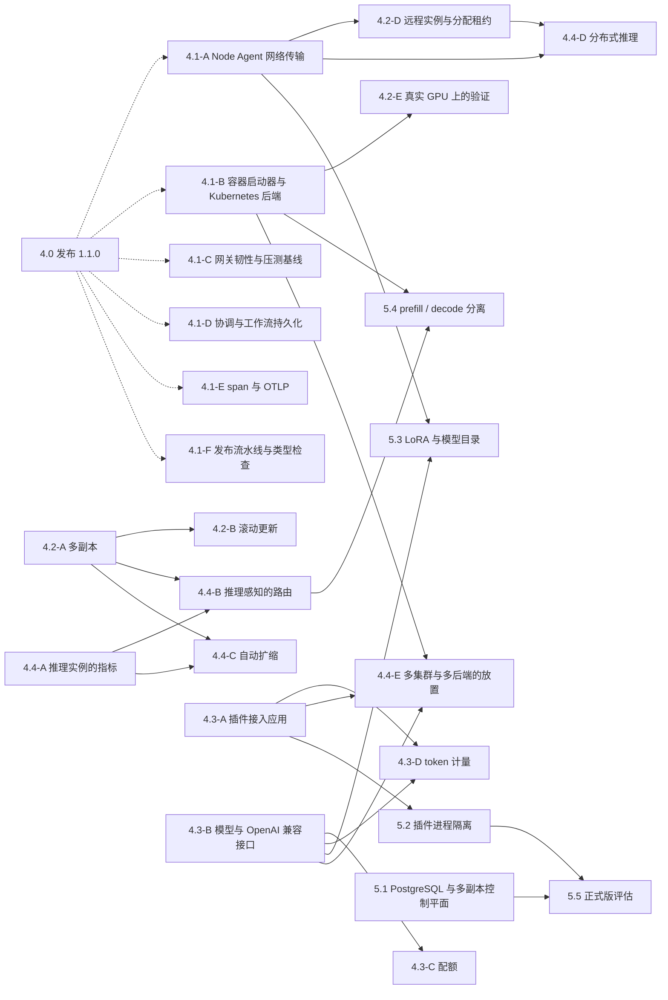

# ForgeMesh 路线图：1.1.0 之后的阶段与迭代

**版本：** 第 2 版（随实施更新）：增加与 KServe、Kthena 的分工（1.2 节），各主题注明承接的遗留问题
**日期：** 2026-10-14
**基线：** `main` = `871cf9b`（已合入 #5–#23）
**状态：** 已采纳，第 1 版经 #24 合入
**依据：** [architecture.md](architecture.md)（第 20 节架构验收标准）、[ADR-006](../design-decisions/adr-006.md)、[ADR-007](../design-decisions/adr-007.md)、[ADR-009](../design-decisions/adr-009.md)、[ADR-013](../design-decisions/adr-013.md)、[ADR-014](../design-decisions/adr-014.md)，#8–#22 的 PR 描述与 ADR-014 中记录的遗留问题，以及 KServe 与 Kthena 的公开文档（截至 2026-10）

---

## 0. 范围与读法

- [v1.1-development-plan.md](v1.1-development-plan.md) 完成之后，#5–#23 又分三批实施：#5–#11 修复数据正确性并加上认证与控制器，#12–#16 打通推理服务的最小闭环，#17–#23 补齐资源的生命周期、可观测性与工程化。本文把这三批记为阶段 1 至阶段 3，后续的工作从阶段 4 开始编号：
  - **阶段 4：执行面与 MaaS 基础**。多节点执行与多副本（Kubernetes 上接入 Kthena 与 KServe 作为执行后端，裸机上经 Node Agent），以及按模型名提供 OpenAI 兼容接口、配额与计量。
  - **阶段 5：生产规模与正式版**。PostgreSQL 与多副本控制平面、插件隔离、LoRA、prefill / decode 分离，最后做正式版评估。
- 每个阶段分成若干迭代，每个迭代由若干主题组成。一个主题对应一个分支与一个 PR，较大的主题拆成几个叠放的 PR。同一迭代内的主题如果没有标注依赖，可以并行开发。
- 本文不估算工期：每个主题写明内容、依赖与验收，规模以涉及的组件与改动范围描述。
- **状态口径**：计划中 / 进行中 / 已完成（附 PR 编号）/ 待定（需要维护者决定，见第 6 节）。目前所有主题都是“计划中”。
- **维护**：每合入一个 PR，更新对应主题的状态；新发现的遗留问题写进第 7 节并指定归属；设计细节写进 ADR 或组件文档，本文只保留结论与链接。

## 1. 现状与定位

### 1.1 1.1.0 具备什么

| 领域 | 已具备（PR） | 尚未具备（归属） |
|---|---|---|
| API 与资源 | `InferenceService` 的创建、读取、`PUT` / `PATCH` 与受控删除；签名的分页游标；统一的错误信封；OpenAPI 契约测试；审计查询（#5、#6、#17、#20、#21） | 只有 `InferenceService` 一种可部署资源，没有模型的抽象（4.3-B） |
| 控制器与调度 | 控制器驱动协调；静态加速器清单上的 first-fit 调度，分配按 uid 幂等、设备独占；修改 `spec` 后重新部署；定期核对实例并重新部署丢失的实例；回收孤立的分配（#7、#13、#14、#18） | 多副本、滚动更新、应用层健康检查、分配租约、以节点心跳作为清单来源（4.1-A、4.2） |
| 运行时 | `fake`、`vllm-process`、`tgi-process` 三个启动器，实例运行在控制平面所在的主机上（#15、#18） | 容器启动器与 Kubernetes 后端（Kthena / KServe）、远程节点、在真实 GPU 上的验证（4.1-B、4.2-D、4.2-E） |
| 网关 | 绑定租户的 API key；按租户限流；按命名空间与协议路由；实例地址白名单；请求体上限；Prometheus 指标；W3C `traceparent`；JSON 错误信封（#6、#8、#9、#21） | 按模型名的 OpenAI 兼容接口、按 key 与模型的配额、token 计量、推理感知的路由、TLS、压测基线（4.1-C、4.3、4.4） |
| 事件与审计 | 资源变更事件与审计记录同事务写入；退避重试与 `dead`；发布到日志或 webhook（#20） | 按资源保序的投递、webhook 请求签名（4.1-D、4.3-E） |
| 可观测 | 两边的 `/metrics`；日志与错误信封带 trace-id 与关联 ID（#21） | span 与 OTLP 导出、推理实例自己的指标（4.1-E、4.4-A） |
| 执行面 | Node Agent 的类型化任务与恢复逻辑（只在进程内调用） | 网络传输（gRPC 加 mTLS）（4.1-A） |
| 插件 | Ed25519 签名与注册时验签；权限由管理员授予；入口可以加载（#16） | 控制平面应用加载插件、决策与计量插件接入、进程隔离（4.3-A、5.2） |
| 存储 | SQLite（WAL），单写者（ADR-013），在线备份（#10） | PostgreSQL、多副本控制平面、有序的迁移脚本（5.1） |
| 工程与部署 | CI：覆盖率下限、依赖漏洞审计、包导入检查、契约测试、格式检查、compose 冒烟；镜像、compose 与带网络策略的 Kubernetes 清单（#11、#22、#23） | 类型检查、镜像发布流水线、GPU 环境中的验证（4.1-F、4.2-E） |

### 1.2 与 Kubernetes 原生推理框架的关系

[KServe](https://kserve.github.io/website/)（CNCF 孵化项目）与 [Kthena](https://kthena.volcano.sh/)（Volcano 子项目）是 Kubernetes 原生的大模型推理平台（KServe 的 `LLMInferenceService` 自 v0.17 起标为生产可用，Kthena 已发布 1.x 版本），覆盖两方面：

- **推理工作负载的编排**：多副本、多机（张量 / 数据 / 专家并行）、prefill / decode 分离、按推理指标扩缩。KServe v0.17 起的 `LLMInferenceService` 基于 llm-d；Kthena 的 `ModelServing` 借助 Volcano 做 gang 调度与网络拓扑感知调度。
- **请求调度**：按模型名路由、KV cache 感知、前缀缓存、LoRA 亲和。KServe 经 Gateway API Inference Extension 的实例选择器（EPP），Kthena 用自带的 router。

两者都以 Kubernetes 为前提，工作负载运行在所在的集群内；不管理 GPU 本身的发现、驱动与健康（交给 GPU Operator 与 device plugin）；没有租户、用于计费的用量记录、审批与审计这类平台层的概念。Kthena router 有认证、token 限流与按用户的公平排队，KServe 经 Envoy AI Gateway 做 token 限流。

ForgeMesh 不在 Kubernetes 上重做这两者已有的能力，各层的分工如下：

| 层 | KServe / Kthena | ForgeMesh |
|---|---|---|
| 资源层：GPU 发现、驱动预检、MIG、节点健康 | 不涉及 | 自己做：`gpu-nvidia`、GPU 上线工作流、Node Agent |
| 工作负载层：多副本、多机、prefill / decode 分离、扩缩 | 核心能力 | Kubernetes 上交给后端（4.1-B）；裸机、单机与边缘环境经 Node Agent 与自己的启动器实现 |
| 请求路由层：按模型名路由、KV cache 感知 | 核心能力 | Kubernetes 后端的请求转发给后端的 router 或网关，由后端选择实例；自己启动的实例由 ForgeMesh 网关路由 |
| 平台治理层：租户、key、配额、计量、审批、审计、模型目录、跨集群与跨后端的放置 | 只有认证、限流与公平排队 | ForgeMesh 的重心，以 ForgeMesh 为准 |

**原则**：

1. Kubernetes 集群上的推理工作负载交给 Kthena 或 KServe 后端：ForgeMesh 下发声明，读回状态与入口地址。
2. 认证、配额与计量只在 ForgeMesh 网关执行一次。转发给后端时关闭或放宽后端的限流，避免重复计数；把已认证的主体传给后端，例如 Kthena 的公平排队需要识别用户。
3. 非 Kubernetes 环境由 ForgeMesh 自己的 Node Agent 与启动器覆盖，这是两者覆盖不到的部分；ForgeMesh 自己实现的部分与它们保持概念一致，便于在两种环境之间迁移。
4. 一个模型可以同时由多个集群与后端提供，放置与故障转移由 ForgeMesh 决定（4.4-E）。

**参考的设计点**：

| 来源 | 设计点 | 用在 |
|---|---|---|
| Kthena | `ModelServing`（工作负载）、`ModelServer`（后端实例池、推理引擎、流量策略）与 `ModelRoute`（按模型名、LoRA 与权重路由）三个资源分开 | 4.3-B 模型的抽象 |
| KServe | `ServingRuntime` 把运行时模板与服务分开；`LocalModelCache` 与 `LocalModelNamespaceCache` 按集群或命名空间缓存模型 | 4.1-B 运行时配置；5.3 权重预下载 |
| Gateway API Inference Extension、llm-d、Kthena router | 实例选择器（EPP）的接口；先过滤再打分的插件框架（最少排队、最低时延、前缀缓存、KV cache 感知、LoRA 亲和） | 4.4-B 路由策略的插件接口 |
| Kthena、KServe | 输入与输出 token 限流（单实例或经 Redis 全局）、按用户的公平排队；Envoy AI Gateway 的 token 限流 | 4.3-C 配额 |
| Kthena、KServe | `AutoscalingPolicy`（突发扩容、稳定窗口、跨实例规格的成本优化）；KEDA 与 WVA 扩缩 | 4.4-C 自动扩缩 |
| KServe、Kthena | LeaderWorkerSet 多机部署与 NIXL KV 传输；按角色组织的实例组、gang 调度与网络拓扑感知调度 | 4.4-D、5.4 |

**命名**：ForgeMesh 的 `InferenceService`（`forgemesh.io/v1alpha1`）与 KServe 的 `InferenceService`（`serving.kserve.io`）同名，KServe 后端的文档与资源映射要写清两者的对应关系。

## 2. 总览

实线是主题之间的硬依赖，虚线表示建议的先后顺序。迭代的划分是建议的推进顺序，同一迭代内的主题可以并行；没有画出的主题（如 4.2-C、4.3-E）不依赖其他主题。

| 迭代 | 目标 | 进入条件 | 退出条件 | 建议版本 |
|---|---|---|---|---|
| 4.0 | 发布 1.1.0 | #5–#23 已合入 | 见 3.1 | 1.1.0 |
| 4.1 | 执行面基础 | 4.0 | 见 3.2 | 1.2.0 |
| 4.2 | 多副本与运行时完善 | 4.1（4.2-A 至 4.2-C 不依赖 4.1，可以提前开始） | 见 3.3 | 1.3.0 |
| 4.3 | MaaS 接入层 | 4.1（4.3-A、4.3-B、4.3-E 可以与 4.2 并行） | 见 3.4 | 1.4.0 |
| 4.4 | 推理感知的路由、扩缩与分布式推理 | 4.2 | 见 3.5 | 1.5.0 |
| 5.1–5.4 | 生产规模 | 见第 4 节各迭代的依赖 | 见第 4 节 | 每个迭代一个 minor 版本 |
| 5.5 | 正式版评估 | 5.1、5.2 | architecture.md 第 20 节全部满足 | 由维护者决定（第 6 节） |

## 3. 阶段 4：执行面与 MaaS 基础

### 3.1 迭代 4.0：发布 1.1.0

- `CHANGELOG.md` 的 `[1.1.0] - Unreleased` 定稿并写上发布日期。
- 新增 `docs/releases/v1.1.md`：汇总 #4–#23 的变化，列出全部「破坏性」条目及其迁移方式，并记录已经声明的弃用（如列表接口的 `tenantId` 查询参数计划在 1.3.0 删除）。
- README「功能概览」按 1.1.0 改写，`docs/architecture/module-mapping.md` 更新版本与核对日期。
- 在 `main` 上跑一遍 CI 的全部 job 与 Kubernetes（kind）演练，然后打标签 `v1.1.0`。

**退出条件**：标签 `v1.1.0` 上 CI 全部通过；发布记录列出每一项破坏性变更与迁移方式。打标签由维护者执行。

### 3.2 迭代 4.1：执行面基础

| 主题 | 内容 | 依赖 | 涉及组件 |
|---|---|---|---|
| 4.1-A Node Agent 网络传输（ADR-009） | 拆成 3 个叠放的 PR：① 由 `api/protobuf/agent.proto` 生成代码，`AgentServer` 与 `AgentClient` 之间改走 gRPC，控制平面与节点之间使用 mTLS（每个节点一张证书）；② 心跳与离线检测：节点超时转为 `NotReady`，其上的实例变为 `Unknown`，断线重连后查询并恢复未完成的任务；③ 节点经心跳上报设备（`gpu-nvidia` 的发现结果），作为调度器的清单来源，静态清单保留为可选来源，设备变化不再需要重启控制平面。承接 #13 的遗留问题 | — | `packages/node-agent`、`api/protobuf/`、调度器的清单来源、部署清单（证书 Secret） |
| 4.1-B 容器启动器与 Kubernetes 后端 | 拆成 3 个 PR：① `container` 启动器：经 Docker / Podman API 在主机上以容器运行实例，GPU 经 CDI 或 `--gpus` 分配，实例由容器运行时管理生命周期，不需要进程启动器那样的实例记录文件；② `kthena` 后端：由 ForgeMesh 的服务生成 Kthena 的 `ModelServing`、`ModelServer` 与 `ModelRoute`，读回状态与入口地址，多副本、prefill / decode 分离、扩缩与 KV cache 感知路由由 Kthena 承担；③ `kserve` 后端：生成 `LLMInferenceService`，同样读回状态与入口地址。两个后端都要求控制平面能访问 Kubernetes API（ServiceAccount 挂载 token，并有对应资源的 RBAC）；运行时的配置参考 KServe 的 `ServingRuntime`，把运行时模板与服务分开。不依赖两者的纯 Pod 启动器是否要做，见第 6 节。承接 #15、#18 与 #22 中 kind 验证的遗留问题 | — | `controlplane/deployment/`、`deploy/kubernetes/` |
| 4.1-C 网关韧性与压测基线 | 连接实例被拒绝时立即刷新这个服务的实例缓存；首字节之前换一个实例重试一次（仅限请求体可以重放的情况）；非流式路由设置 `ReadTimeout`；限流器分片，GC 移到后台；缓存过期时先返回旧值，同时在后台刷新；可选的 TLS；认证之前的连接与请求速率限制（目前由前置负载均衡或 WAF 承担）。压测基线（首字节时延 P99、并发流数、控制平面写入吞吐）写进文档，并在 CI 中做回归。承接 #9、#18、#22 与 ADR-014 的遗留问题 | — | `gateway/` |
| 4.1-D 协调与工作流持久化 | 审批决定与协调的退避计数（包括实例丢失后重新部署的退避）持久化，重启后不丢失；工作流运行结束时经 Outbox 事件通知控制器，取代每 2 秒一次的轮询，事件按资源保序投递；提供工作流运行的查询接口；Temporal Provider 实现 `find_run` 与步骤输出，能够运行部署工作流。承接 #14、#18、#20 的遗留问题 | — | `controlplane/reconciler/`、`controller/`、`workflow-runtime`、`plugins/workflow-temporal` |
| 4.1-E span 与 OTLP | 记录 span 并经 OTLP 导出。OpenTelemetry SDK 作为可选依赖，未配置导出地址时不启用；`forgemesh.controlplane.observability` 中不经 `/metrics` 输出的内存记录器改为 `/metrics` 的实现或删除。承接 #21 的遗留问题 | — | 控制平面、网关 |
| 4.1-F 发布流水线与类型检查 | 构建并发布镜像（推送到镜像仓库、签名、SBOM）；提供包含 vLLM 与 TGI 的 GPU 镜像变体（仓库目前的控制平面镜像两者都不含）；类型检查（mypy 或 pyright），先在控制平面包上严格执行。承接 #11、#15 的遗留问题 | — | `.github/workflows/`、`deploy/docker/` |

**退出条件**：控制平面与 Node Agent 作为两个独立的进程经真实网络联调，这项测试进入 CI；断网恢复后同一个任务不会重复执行；使用伪造证书的节点被拒绝。容器启动器进入 compose 冒烟；Kthena 或 KServe 后端在 kind 上以 CPU 上运行的小模型跑通创建、`Ready`、对话、更新与删除。网关的压测基线写进文档。控制器不再轮询工作流运行。

### 3.3 迭代 4.2：多副本与运行时完善

| 主题 | 内容 | 依赖 |
|---|---|---|
| 4.2-A 多副本 | `spec.availability.replicas` 生效。ForgeMesh 自己的启动器（本机与 4.2-D 的远程实例）：调度器为每个副本分配加速器，每个副本一个部署运行，`status.endpoints` 列出全部副本，网关在 ready 的副本之间轮询；缩容时先摘除 endpoint，再停止实例。Kubernetes 后端：副本数下发给 Kthena 或 KServe，状态从后端读回。承接 #14、#15 的遗留问题 | — |
| 4.2-B 滚动更新 | ForgeMesh 自己的启动器按 `maxSurge` / `maxUnavailable` 先起后停，加速器不够时退回先停后起，更新期间服务不中断；Kubernetes 后端的滚动更新由后端执行。承接 #18 的遗留问题 | 4.2-A |
| 4.2-C 应用层健康检查 | 按协议定期探测 ForgeMesh 自己启动的实例（如 `GET /health`），连续失败的副本从 endpoint 中摘除，再按实例丢失的流程重新部署，实例核对不再只看进程是否还在运行；Kubernetes 后端以后端报告的就绪状态为准。承接 #18 的遗留问题 | — |
| 4.2-D 远程实例与分配租约 | 新增经 Node Agent 在远程节点上启动实例的启动器；远程节点持有的分配带租约，节点失联超过租约时回收分配并重新调度。承接 #13、#15 的遗留问题 | 4.1-A |
| 4.2-E 真实 GPU 上的验证 | `vllm-process`、`tgi-process`、容器启动器与 Kubernetes 后端在 GPU 节点上跑通推理服务的完整闭环（创建、`Ready`、对话、更新、实例丢失、删除）；需要自托管的 GPU runner，或者把手工演练的记录写进文档。承接 #18、#22 的遗留问题 | 4.1-B |
| 4.2-F 按期移除已弃用的接口 | 列表接口的 `tenantId` 查询参数按弃用声明在 1.3.0 删除（OpenAPI 与实现一起删除，CHANGELOG 标注「破坏性」） | — |

**退出条件**：在假运行时上，3 个副本的服务被杀掉一个副本之后不中断服务，滚动更新期间的请求全部成功；至少一个真实运行时在 GPU 上验证过并有记录。

### 3.4 迭代 4.3：MaaS 接入层

| 主题 | 内容 | 依赖 |
|---|---|---|
| 4.3-A 插件接入应用 | 启动时按插件策略文件加载插件（新增环境变量）；决策插件接入决策路由，`/api/v1/decisions` 变为可用；计量与 QoS 插件接入策略引擎；插件注册时的制品摘要写入审计；受信任的公钥绑定插件 id，授予绑定签名者，支持密钥轮换与吊销。承接 #16 的遗留问题 | — |
| 4.3-B 模型与 OpenAI 兼容接口 | 引入模型的抽象（需要 ADR），参考 Kthena 把工作负载、后端实例池与按模型名的路由分成三个资源的做法：新资源 `Model`，或者在 `InferenceService` 上声明对外的模型名。网关提供 `/v1/models`、`/v1/chat/completions`、`/v1/completions` 与 `/v1/embeddings`，按请求中的 `model` 路由到提供这个模型的服务；新协议 `openai-embeddings`；CLI 能管理模型。同一个模型可以由多个服务、多个副本与多个后端提供，与 4.2-A、4.4-E 一起设计实例与后端的选择。承接 #19 的遗留问题 | — |
| 4.3-C 配额 | 按 API key 与模型的 RPM / TPM 配额，只在 ForgeMesh 网关执行，超出时返回 `429` 与 `Retry-After`；转发给 Kthena router 或 KServe 网关时关闭或放宽它们的限流，避免重复计数。配额从哪里来（key 文件还是控制平面 API），以及多个网关副本之间如何共享计数，需要先定下来（ADR）；做法参考 Kthena 的输入与输出 token 限流（单实例或经 Redis 全局）与按用户的公平排队 | 4.3-B |
| 4.3-D token 计量 | 不论请求由哪个后端处理，都由 ForgeMesh 网关从响应与流（`stream_options.include_usage`）中读取用量，经计量插件追加 `UsageRecord`（租户、key、模型、输入与输出 token）；提供按租户查询用量的接口与计量修正事件；租户隔离覆盖计量 | 4.3-A、4.3-B |
| 4.3-E 认证的后续（ADR-014） | key 文件热加载、过期时间与最近使用时间，不重启就能轮换与吊销 key；按主体（而不只是按租户）限流；网关到控制平面使用 mTLS；推理实例或后端需要凭证时，由网关以服务端配置注入；把已认证的主体传给后端（例如 Kthena 的公平排队要识别用户）；webhook 请求签名；OIDC / JWT 作为新的 `Authenticator` 实现（另行 ADR）。承接 ADR-014 与 #20 的遗留问题 | — |

**退出条件**：OpenAI 官方 SDK 只修改 `base_url` 与 key，就能以流式与非流式调用 `/v1/chat/completions`；超出 TPM 时返回 `429`；计量记录与响应中的 `usage` 一致。

### 3.5 迭代 4.4：推理感知的路由、扩缩与分布式推理

| 主题 | 内容 | 依赖 |
|---|---|---|
| 4.4-A 推理实例的指标 | 采集 ForgeMesh 自己启动的实例的排队请求数、KV cache 占用与前缀缓存命中（vLLM / TGI 的 `/metrics`），由 Node Agent 或控制平面汇总，供网关与扩缩使用；Kubernetes 后端的指标由后端自己采集，ForgeMesh 只读取汇总值，用于状态与放置 | — |
| 4.4-B 推理感知的路由 | ForgeMesh 网关为自己启动的实例提供可配置的路由策略：轮询（默认）、最少排队、KV cache 感知、前缀亲和；插件接口参考 Gateway API Inference Extension 的实例选择器（EPP）与 Kthena router 先过滤再打分的框架。Kubernetes 后端的请求在 ForgeMesh 网关完成认证、配额与计量之后，转发给后端的 router 或网关，由后端选择实例 | 4.2-A、4.4-A |
| 4.4-C 自动扩缩 | ForgeMesh 自己的启动器按推理指标（排队请求数、KV cache 占用、首 token 时延）在 min / max 之间调整副本数，带冷却时间，缩容到 0 作为可选项并写明冷启动的代价；Kubernetes 后端把扩缩策略下发为 Kthena 的 `AutoscalingPolicy` 或 KServe 的 KEDA 配置 | 4.2-A、4.4-A |
| 4.4-D 分布式推理 | 一个实例跨多台机器。裸机：经 Node Agent 在多台机器上协调启动（vLLM 的 Ray 后端，或多节点的张量并行 / 流水线并行），调度器按拓扑分配 GPU（节点内张量并行、跨节点流水线并行，考虑 NVLink 与 InfiniBand 亲和），部署工作流增加多节点的准备与验证步骤。Kubernetes：由后端承担（Kthena 按角色组织的实例组与 gang 调度、KServe 的 LeaderWorkerSet） | 4.1-A、4.2-D |
| 4.4-E 多集群与多后端的放置 | 同一个模型可以由多个集群或后端提供，例如一个 Kubernetes 集群中的 Kthena 与另一处的裸机节点。放置决策由决策 Provider 按成本、SLA、数据驻留与租户策略提出，Policy 与 Scheduler 做最终授权（ADR-005）；网关按放置结果与后端的健康在后端之间路由与故障转移。Kthena 与 KServe 不覆盖这一部分：两者的工作负载都在所在的 Kubernetes 集群内 | 4.1-B、4.3-A、4.3-B |

**退出条件**：在假运行时上能重复演示指标驱动的路由与扩缩；两节点的分布式部署在 GPU 环境中跑通，并有记录；一个模型同时由两个后端提供时按策略放置，其中一个后端不可用时请求转到另一个。

## 4. 阶段 5：生产规模与正式版

| 迭代 | 内容 | 依赖 |
|---|---|---|
| 5.1 PostgreSQL 与多副本控制平面（ADR-007、ADR-013） | 注册中心、Outbox、审计与工作流存储放进同一个 PostgreSQL 数据库，消除两个 SQLite 文件之间没有事务的问题；契约测试在两种后端上都运行；以有序的迁移脚本取代按 `PRAGMA table_info` 探测的迁移；SQLite 到 PostgreSQL 的迁移工具与演练文档；实现 leader 选举（例如 PostgreSQL advisory lock）之后允许多副本，只有 leader 运行控制器；`decision-api`、`workflow-runtime` 与 `metering-basic` 插件各自打开的 SQLite 连接一并迁移；ADR-013 更新状态。承接 #10、#15 的遗留问题 | 阶段 4 |
| 5.2 插件进程隔离（ADR-006） | 实现受限 RPC 宿主（子进程或容器），或者按实际情况修订 ADR-006；最小权限与出网白名单；清单的 `isolation` 支持进程与容器隔离，高风险插件必须隔离运行；性能基线。承接 #16 的遗留问题 | 4.3-A |
| 5.3 LoRA 与模型目录 | 同一个基础模型上动态加载多个 LoRA 适配器，按 `model` 名路由到适配器；模型目录：版本、摘要校验（`spec.model.digest` 生效）、经 Node Agent 把权重预先下载到节点 | 4.3-B、4.1-A |
| 5.4 prefill / decode 分离 | 预填充与解码由不同的实例承担，KV cache 在实例之间传输，路由协调两者。Kubernetes 上由后端承担（Kthena `ModelServing` 的 prefill / decode 角色与 PD 感知路由、KServe `LLMInferenceService` 的 `spec.prefill` 与 NIXL KV 传输），ForgeMesh 只负责声明与状态；裸机路径上是否自己实现由维护者决定（第 6 节），实现时参考 llm-d 与 AIBrix 的做法 | 4.1-B（Kubernetes）；4.4-B（裸机） |
| 5.5 正式版评估 | 按 architecture.md 第 20 节逐项验收（见下表）；满足之后把 OpenAPI 的 `x-stability` 改回 `stable`，按弃用政策决定版本号，发布正式版的发布记录 | 5.1、5.2 |

**退出条件**：5.1 的两种后端都通过契约测试；在两个副本的控制平面中，leader 退出之后另一个副本接管，资源状态不丢失。5.2 的高风险插件只能在隔离宿主中运行。5.5 的验收表全部满足。

**正式版验收表**：对照 architecture.md 第 20 节，列出 1.1.0 尚未满足的条目与关闭它们的迭代。其余条目在 5.5 逐项复核。

| 验收条目（第 20 节） | 1.1.0 的情况 | 关闭的迭代 |
|---|---|---|
| 20.1 核心模块与插件边界明确 | 插件有签名与授权，但控制平面应用不加载插件 | 4.3-A |
| 20.2 资源状态与实际执行结果可核验 | 实例核对只看进程是否还在运行 | 4.2-C |
| 20.2 工作流具有持久化、恢复、幂等、重试和补偿机制 | 运行持久化并可恢复；审批决定与协调的退避计数只在内存中 | 4.1-D |
| 20.2 Agent 断线重连后可以查询和恢复未完成任务 | Node Agent 只在进程内调用 | 4.1-A |
| 20.3 租户隔离覆盖资源、工作流、审计和计量 | 资源与审计已隔离；计量没有接入 | 4.3-D |
| 20.3 高风险插件具备隔离执行机制 | 插件都在宿主进程内运行 | 5.2 |
| 20.3 节点任务经过认证、授权和参数校验 | 任务是类型化的，但没有网络传输与节点认证 | 4.1-A |
| 20.4 至少有一个完整的 GPU Provider | `gpu-nvidia` 能发现设备，但没有接入调度 | 4.1-A |
| 20.4 至少有一个完整的推理 Runtime Provider | 控制平面自带进程启动器，没有在真实 GPU 上验证；插件中的默认 launcher 未实现 | 4.2-E |
| 20.4 WorkEngine 的运行契约不绑定唯一执行引擎 | Temporal Provider 只有内存客户端，不能运行部署工作流 | 4.1-D |
| 20.4 决策 Provider 可以替换 | 控制平面应用不注入决策路由，`/api/v1/decisions` 返回 `503` | 4.3-A |
| 20.5 有统一的日志、指标、追踪与诊断关联 ID | 日志、指标与 trace-id 已统一；不导出追踪 | 4.1-E |
| 20.5 有可查询的工作流历史和审计记录 | 审计记录可查询；工作流运行没有查询接口 | 4.1-D |

## 5. 开发与迭代方式

- **分支与 PR**：一个主题一个分支、一个 PR；较大的主题拆成叠放的 PR，每个 PR 都能单独评审，描述中写明依赖与只含本 PR 改动的对比链接。
- **提交**：遵循 Conventional Commits，并签署 DCO；一个逻辑修改一个提交，每个提交单独检出时 CI 全部通过。
- **每个主题的流程**：
  1. 先确认设计，需要时写 ADR（Proposed，评审后改为 Accepted）；
  2. 实现：每个行为变化都有在旧代码上失败的测试；
  3. 扩展 compose 冒烟覆盖新功能；需要 GPU 的项目写明验证环境与演练记录；
  4. 同步 CHANGELOG、README、OpenAPI 与 module-mapping；
  5. 合入之后更新本文对应主题的状态。
- **破坏性变更**：API 稳定性为 `beta`，minor 版本可以包含破坏性变更，但 CHANGELOG 必须以「破坏性」标注并写明迁移方式（[弃用政策](../governance/deprecation-policy.md) 1.4 节）。已经声明的弃用按期移除。
- **版本**：建议每完成一个迭代发布一个 minor 版本（见第 2 节的表），由维护者决定。
- **后端适配**：接入 Kthena 与 KServe 的代码集中在各自的后端中；CI 在 kind 上以 CPU 上运行的小模型，测试文档中写明支持的版本。
- **验证环境**：CI 只覆盖不需要 GPU 的部分（假运行时与 CPU 小模型）。4.2-E、4.4-D、5.3、5.4 需要真实 GPU：单机多卡，以及以 InfiniBand 或 RoCE 互联的两台机器。

## 6. 需要维护者决定的事项

| 事项 | 影响的主题 | 选项 |
|---|---|---|
| 新的第三方依赖 | 4.1-A、4.1-E | Node Agent 传输引入 `grpcio` 与 `protobuf`；OTLP 导出引入 OpenTelemetry SDK（可选依赖） |
| 模型的抽象 | 4.3-B、5.3 | 新增 `Model` 资源；或在 `InferenceService` 上声明对外的模型名 |
| Kubernetes 后端的先后 | 4.1-B | 先接 Kthena（自带 router，与 ForgeMesh 网关的分工简单）；或先接 KServe（`LLMInferenceService` 自 v0.17 起生产可用）。两者都接时各自一个 PR |
| 纯 Pod 启动器 | 4.1-B | 不做，Kubernetes 上一律经 Kthena 或 KServe；或作为没有安装两者的集群的兜底 |
| 裸机路径上的 prefill / decode 分离 | 5.4 | 自己实现；或只在 Kubernetes 后端上提供 |
| 配额与 key 的来源 | 4.3-C、4.3-E | 继续使用 key 文件；或由控制平面管理 key 与配额并下发给网关。另需确定多个网关副本之间如何共享限流计数 |
| GPU 验证环境 | 4.2-E、4.4-D、5.3、5.4 | 自托管的 GPU runner；或在文档中保留手工演练的记录 |
| 覆盖率下限 | 全部 | 保持 `fail_under = 97`（实测 97.2%）；或调为 96，留出余量 |
| 发布节奏 | 全部 | 每个迭代一个 minor 版本；或按固定节奏发布 |
| 正式版的版本号 | 5.5 | 由弃用政策与届时的破坏性变更决定 |

## 7. 遗留问题的归属

下表列出 #8–#22 的 PR 描述、ADR-014 与 1.1.0 的文档和验证记录中尚未解决的遗留问题，已经由后续 PR 解决的不再列出；第 3、4 节中承接它们的主题都注明了来源。#5–#7、#12、#23 的描述没有遗留问题；#8 与 #17 的遗留问题已由后续 PR 解决；ADR-014 中的「审计事件记录 `Principal.subject`」与「以 Secret 挂载 key 文件」已由 #20 与 #11 完成。

| 来源 | 遗留问题 | 归属 |
|---|---|---|
| ADR-014（#6） | OIDC / JWT 与 mTLS 作为新的认证方式；key 文件热加载、过期时间与最近使用时间 | 4.3-E |
| ADR-014「代价与约束」 | 推理实例需要凭证时，应由网关以服务端配置注入 | 4.3-E |
| ADR-014「代价与约束」 | 认证失败的请求不进入限流，入口的洪泛防护目前由前置负载均衡或 WAF 承担 | 4.1-C |
| CHANGELOG 1.1.0 Deprecated | 列表接口的 `tenantId` 查询参数已弃用，计划在 1.3.0 删除 | 4.2-F |
| #9 网关加固 | 缓存过期时先返回旧值、TLS、限流器分片、首字节之前的重试、非流式路由的 `ReadTimeout`、压测基线 | 4.1-C |
| #10 SQLite | 专用写线程与只读连接、标签索引表、基于 `user_version` 的迁移 | 5.1（迁移改为有序的迁移脚本；写线程与标签表在实现 PostgreSQL 时一并评估） |
| #10 SQLite | `decision-api`、`workflow-runtime` 与 `metering-basic` 插件各自打开的 SQLite 连接没有统一配置 | 5.1 |
| #11 部署 | 镜像的构建与发布流水线；类型检查 | 4.1-F |
| #13 调度 | 分配没有租约，不会到期回收 | 4.2-D |
| #13 调度 | 不重启就重新加载设备清单；以 Node Agent 心跳作为清单来源 | 4.1-A |
| #14 工作流 | 忽略 `availability.replicas` | 4.2-A |
| #14 工作流 | 进度靠轮询；审批决定与重试计数只在内存中 | 4.1-D |
| #14 工作流 | Temporal Provider 不能运行部署工作流 | 4.1-D |
| #15 启动器 | 没有容器与 Kubernetes 启动器 | 4.1-B |
| #15 启动器 | 没有经 Node Agent 的远程启动；每个服务只有一个实例 | 4.2-D、4.2-A |
| #15 启动器 | 控制平面镜像不包含 vLLM（TGI 同样不包含） | 4.1-F |
| #15 启动器 | 两个数据库文件之间没有跨文件事务 | 5.1；在此之前按备份文档的顺序备份 |
| #16 插件 | 控制平面应用不加载插件，策略文件没有环境变量 | 4.3-A |
| #16 插件 | 公钥不绑定插件 id，授予不绑定签名者，没有密钥轮换与吊销；制品摘要没有写入审计 | 4.3-A |
| #16 插件 | 没有进程隔离与出网白名单，ADR-006 需要真正的受限 RPC 宿主或修订 | 5.2 |
| #18 更新与健康 | 更新是先停后起，期间服务不可用 | 4.2-B |
| #18 更新与健康 | 核对实例只看进程是否还在运行 | 4.2-C |
| #18 的实现（README「部署推理服务」） | 实例丢失后重新部署的退避只记在内存中，控制平面重启后从头开始 | 4.1-D |
| #18、#22 | 网关缓存实例列表 5 秒，重新部署之后的几秒内返回 `502` | 4.1-C |
| #18 更新与健康 | vLLM 与 TGI 没有在真实 GPU 上验证，tgi-process 只用桩命令测试过 | 4.2-E |
| #18 更新与健康 | PID 命名空间的编号会被复用，“忽略另一个 PID 命名空间的记录”的判断不完全可靠 | 4.1-B：容器与 Kubernetes 启动器由容器运行时管理实例，不依赖这些记录；进程启动器保留现有的防护（pid 与启动时间都一致才发信号） |
| #19 CLI | 只管理 `InferenceService` | 4.3-B |
| #20 Outbox 与审计 | 事件只尽力按写入顺序投递，没有按资源保序 | 4.1-D |
| #20 Outbox 与审计 | webhook 只用 bearer token 认证，没有请求签名 | 4.3-E |
| #21 可观测性 | 不记录 span，没有 OTLP 导出；内存记录器不经 `/metrics` 输出 | 4.1-E |
| #22 CI 与部署 | 覆盖率下限与实测值只差 0.2 个百分点 | 第 6 节（待定） |
| #22 CI 与部署 | vLLM 与 TGI 启动器没有在 Kubernetes 上验证 | 4.2-E |
| #22 的 kind 验证 | TGI 实例的私有目录可能残留在临时目录（Kubernetes 上是 emptyDir）中 | 4.1-B |

## 8. 风险

- **Node Agent 传输是阶段 4 的关键路径**：4.2-D、4.4-D 与 5.3 都依赖它，证书的签发、分发与轮换需要先设计好。
- **多副本带来的一致性问题**：多个网关副本之间的限流与配额计数需要协调；5.1 之前控制平面必须保持单副本（ADR-013）。
- **真实运行时长期缺少 GPU 验证**：启动器的命令行参数与就绪检查可能与实际的 vLLM / TGI 版本不符，4.2-E 越晚，发现得越晚。
- **Kubernetes 后端的 API 演进**：Kthena 1.x 与 KServe 0.x 的 CRD 仍在变化（例如 Kthena 的 `ModelBooster` 在 v1.1 弃用），后端适配要按支持的版本测试，并在文档中写明支持的版本范围。
- **外部项目的接口变化**：vLLM 与 TGI 的指标名、KV cache 传输库与 OpenAI 接口的新字段都可能变化，相关代码应当集中在启动器与协议适配层中。
- **PostgreSQL 迁移**：需要数据迁移、双写过渡与回退方案，并在演练文档中验证。
